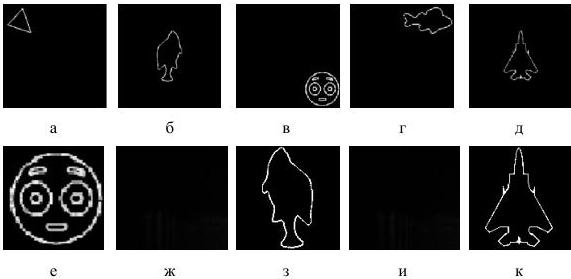

камера машинного зрения Vieworks VA-29MG2-M2A0-FM. Камера имела следующие характеристики: общее количество пикселей – 6576×4384, размер пикселя 5 мкм ×5 мкм, разрядность аналого-цифрового преобразователя камеры - 8, 10, 12 бит, максимальная частота съемки полного кадра – 2,3 Гц, диапазон возможных значений времен экспозиции – от 16 мкс до 7 с. Во время съемки камера перемещается вдоль оптической оси, а регистрация производится в положениях фокусировки плоскостей. Расстояние от ПВМС до фотосенсора варьировалось от 25 до 40 см.

Для численного синтеза ДОЭ и оптического восстановления объемных сцен было использовано два набора бинарных изображений, представленных на рис. 4.2.

Рис. 4.2. Наборы исходных бинарных изображений

Первый набор сцен, представленный на рис. 4.2(а-д), содержал 5 плоскостей, изображения в каждой из которых расположены в центре рабочей области. Второй набор сцен, представленный на рис. 4.2(е-к), содержал 3 информативные плоскости, изображения в которых расположены в центре рабочей области (рис. 4.2 (е, з, к)) и 2 неинформативные черные плоскости (рис. 4.2 (ж, и)). Данное

42