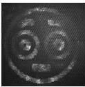

а

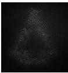

е

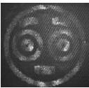

л

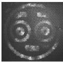

р

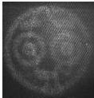

б

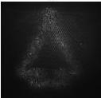

ж

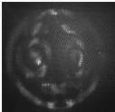

м

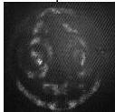

с

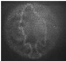

в

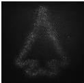

з

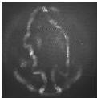

н

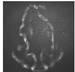

т

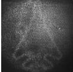

г

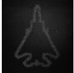

и

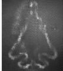

о

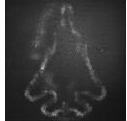

у

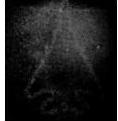

д

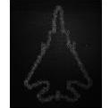

к

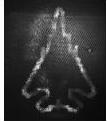

п

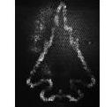

ф

Рис. 4.3. Результаты оптического восстановления для ДОЭ, синтезированных методами суперпозиций (а-д), последовательный «пинг-понг» (е-к), глобальный «пинг-понг» (л-п) и на основе невыпуклой оптимизации (р-ф)

Как видно из рис. 4.3(е-к), для ДОЭ, синтезированного методом последовательный «пинг-понг», качество восстановленного изображения

44