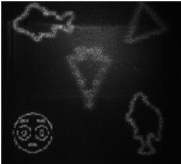

Рис. 4.4. Пример восстановления среза объемной сцены

На рис. 4.5 представлены примеры трехмерных объектов, оптически восстановленных с ДОЭ, синтезированных многоплоскостными методами, отобранными в результате анализе методов в Главе 1.

Изображения на рис. 4.5(а,е,л,р) являются отснятыми в плоскости ближайшего к ПВМС сфокусированного изображения объемной сцены (т.е. первой плоскости), восстановленного с ДОЭ, синтезированного различными методами. Изображения на рис. 4.5(б,ж,м,с) являются кадрами для второй плоскости объемного изображения, восстановленного с ДОЭ, синтезированного различными методами. Для других изображений связь с кадрами представляется аналогично.

46