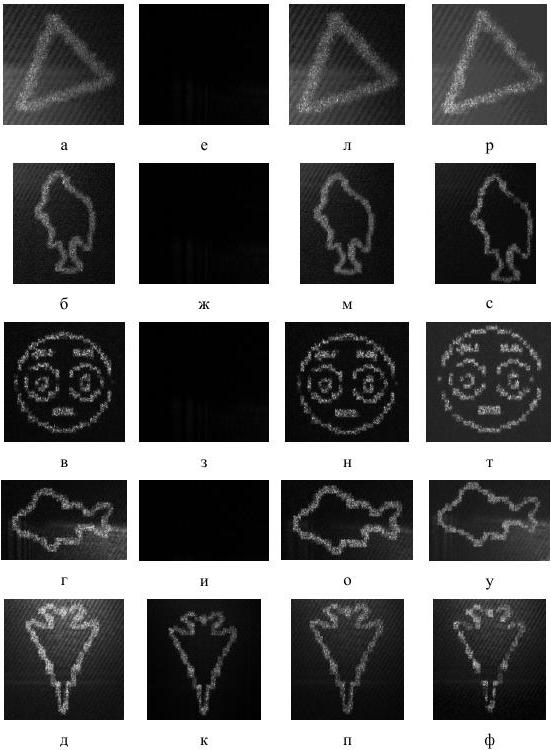

Рис. 4.5. Результаты оптического восстановления сечений сцен с ДОЭ, синтезированных методами суперпозиций (а-д), последовательный (е-к) и глобальный «пинг-понг» (л-п), на основе невыпуклой оптимизации (р-ф)

47