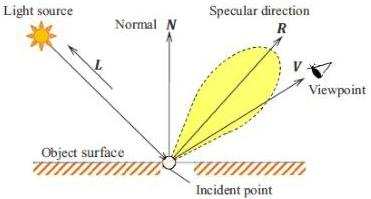

где  \( \lambda \)  – длина волны и  \( a_{0} \)  – комплексная константа, представляющая начальную фазу и амплитуду точечного элемента объекта. В первой строке выражения (1.1) знаменатель в амплитудной части иногда заменяется константой, т.к. это практически не влияет на качество восстановления для случая приближения плоских волн.

Лучи, которые испускают источники излучения, являются первичными, а отраженные от объекта - вторичными. При пересечении первичных лучей с объектом сцены порождаются вторичные лучи, которые играют ключевую роль в формировании изображения. При распространении от объекта вторичных лучей, они преломляются и/или отражаются (см. рис. 1.1) [12].

Рис. 1.1. Схема поточечного метода синтеза ДОЭ

Для каждого отсчета ДОЭ рассчитывается его комплексная амплитуда:

\[
h _ {m} (x, y) = \sum_ {j = 1} ^ {N} \frac {A _ {j}}{r _ {j} (x , y)} \exp \left(i \frac {2 \pi}{\lambda} r _ {j} (x, y) + i \phi_ {j}\right), \tag {1.2}
\]

где

\[
r _ {j} (x, y) = \sqrt {\left(x - x _ {j}\right) ^ {2} + \left(y - y _ {j}\right) ^ {2} + z _ {j} ^ {2}}, \tag {1.3}
\]

x, y – координаты в плоскости ДОЭ, j - номер текущего отсчета, N - полное количество отсчетов, r - радиус-вектор распространения,  \( A_{j} \)  -

9